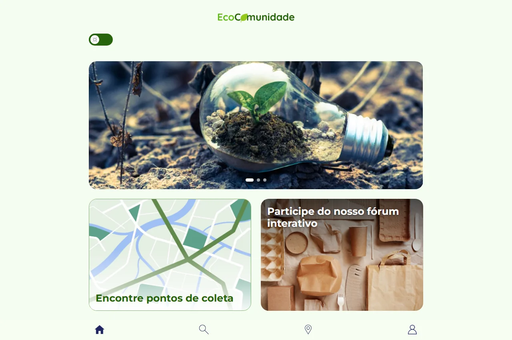
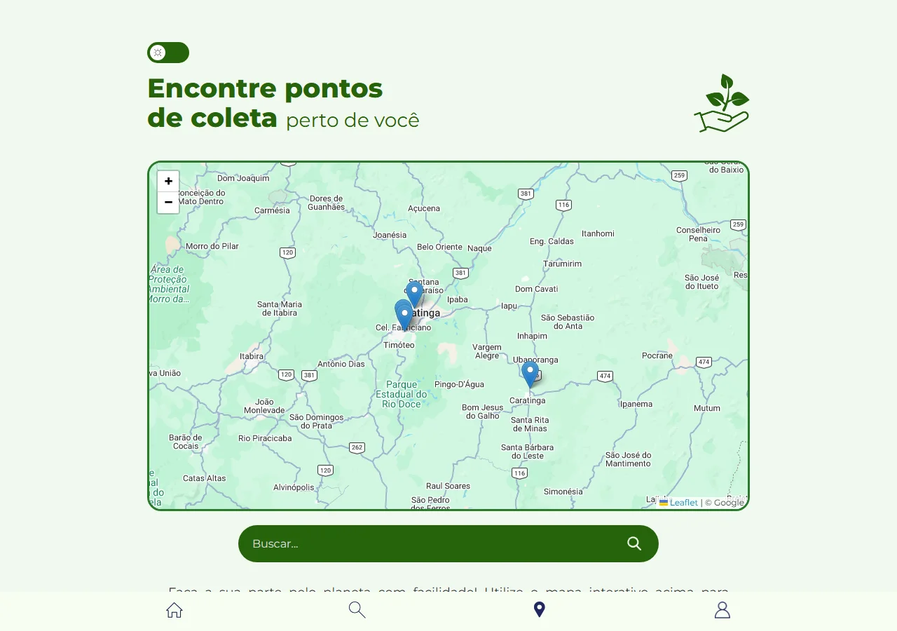
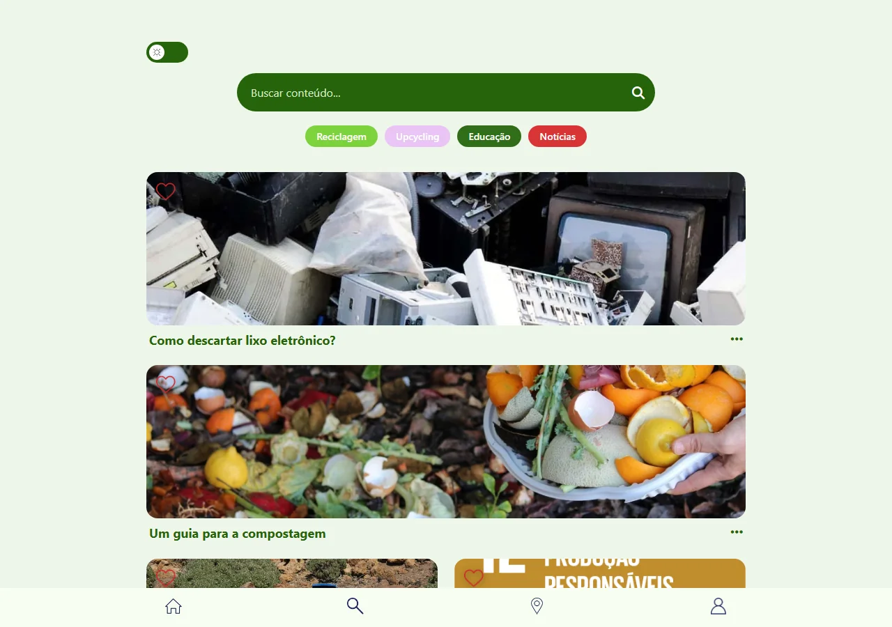
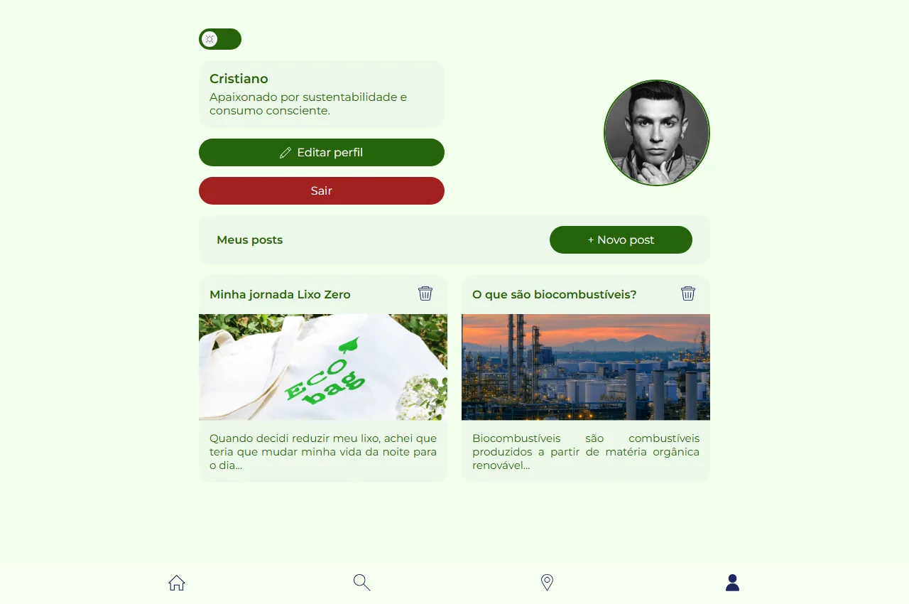
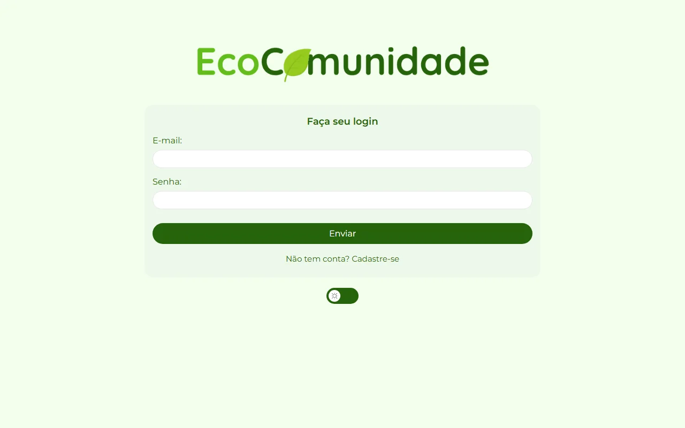
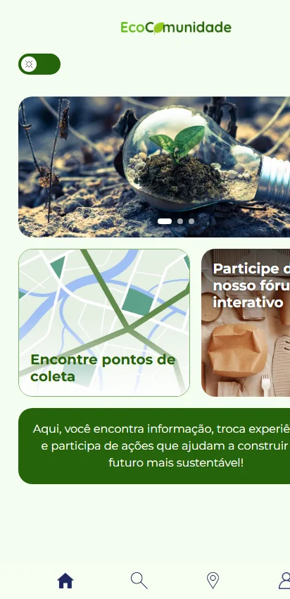
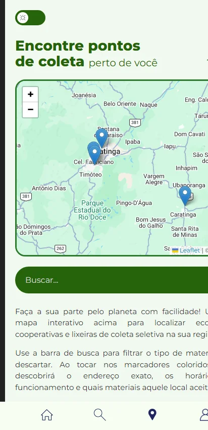
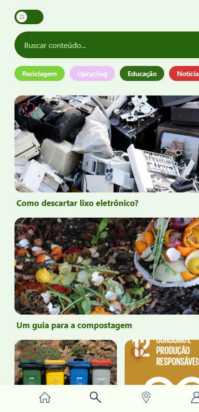

# Ecocomunidade - Coleta Seletiva e Sustentabilidade

Aplicacao web voltada para a conscientizacao ambiental, localizacao de pontos de coleta seletiva e engajamento comunitario por meio de um blog interativo. O sistema permite que moradores encontrem ecopontos e cooperativas de reciclagem na regiao, leiam artigos educativos sobre sustentabilidade e compartilhem suas proprias experiencias e praticas sustentaveis.

---

## Funcionalidades Principais

- **Pagina Inicial (Home):** Apresenta um carrossel automatico e interativo de imagens tematicas, atalhos rapidos para o mapa de pontos de coleta e para o blog da comunidade, alem de navegacao inferior fixa.
- **Mapa Interativo de Pontos de Coleta:** Integrado com a biblioteca Leaflet, exibe marcadores reais de cooperativas e pontos de descarte na regiao (carregados dinamicamente a partir de `data/mapa.json`). Conta com filtro de busca por cidade, bairro ou nome do ponto e exibe detalhes de endereco, materiais aceitos, horario de funcionamento e telefone em pop-ups no mapa.
- **Blog e Comunidade:** Exibe postagens educativas carregadas via JSON (`data/blog.json`) integradas aos posts publicados pelos usuarios da plataforma. Possui sistema de busca em tempo real por titulo, filtragem por categorias (Reciclagem, Upcycling, Educacao e Noticias), sistema de curtidas persistente e visualizacao do texto completo em janela modal (pop-up).
- **Perfil do Usuario:** Permite visualizar e editar nome, biografia e fotografia de perfil (com upload de imagem convertido e salvo em formato JSON), alem de criar novas publicacoes com imagem e excluir postagens existentes, refletindo automaticamente no feed do Blog.
- **Autenticacao (Login e Cadastro):** Sistema de criacao de conta e autenticacao de usuarios com validacao de credenciais e persistencia de dados estruturados em JSON.
- **Tema Claro e Escuro:** Alternancia global de tema claro/escuro disponivel em todas as paginas por meio de um componente unificado (`css/tema.css` e `js/tema.js`), mantendo a preferencia salva durante toda a navegacao.
- **Otimizacao de Imagens:** Todos os recursos visuais e icones da aplicacao utilizam o formato `.webp`, reduzindo o tempo de carregamento e o consumo de banda sem perda de qualidade.

---

## Responsividade (Mobile, Tablet e Desktop)

O layout foi desenvolvido seguindo a abordagem *Mobile-First* e adaptado para diferentes tamanhos de tela utilizando CSS Grid, Flexbox e Media Queries (`@media (min-width: 768px)`):

- **Dispositivos Moveis (ate 767px):** Layout compacto centralizado (`max-width: 480px`), pensado para uso com uma mao, barra de navegacao fixa na parte inferior da tela e cards empilhados verticalmente para leitura fluida.
- **Tablets e Desktops (a partir de 768px):** Expansao proporcional dos containers (`max-width: 800px` a `900px`), organizacao dos posts e atalhos em grades de duas colunas, ajuste automatico das dimensoes do mapa interativo e centralizacao das barras de pesquisa.
- **Tratamento de Imagens Enviadas pelo Usuario:** As imagens adicionadas em novos posts mantem o enquadramento proporcional (`object-fit: contain`) dentro dos cards e dos pop-ups modais, evitando cortes indesejados ou distorcoes independentemente da proporcao original do arquivo enviado.

---

## Capturas de Tela

### Visao Desktop

**Pagina Inicial (Home)**


**Mapa de Pontos de Coleta**


**Blog e Comunidade**


**Perfil do Usuario**


**Tela de Login**


---

### Visao Mobile (Responsiva)

| Home (Mobile) | Mapa (Mobile) | Blog (Mobile) |
| :---: | :---: | :---: |
|  |  |  |

---

## Estrutura de Pastas

```text
.
├── home.html
├── blog.html
├── mapa.html
├── perfil.html
├── login.html
├── cadastro.html
├── css/
│   ├── home.css
│   ├── blog.css
│   ├── mapa.css
│   ├── perfil.css
│   ├── login.css
│   ├── cadastro.css
│   └── tema.css
├── js/
│   ├── home.js
│   ├── blog.js
│   ├── mapa.js
│   ├── perfil.js
│   ├── login.js
│   ├── cadastro.js
│   └── tema.js
├── data/
│   ├── blog.json
│   ├── mapa.json
│   └── perfil.json
└── imgs/
    └── (arquivos de imagem e icones otimizados em .webp)
```

---

## Tecnologias Utilizadas

- **HTML5:** Estrutura semantica das paginas, formularios e janelas modais.
- **CSS3:** Estilizacao responsiva com Flexbox, CSS Grid, Media Queries e suporte a tema escuro.
- **JavaScript (ES6+):** Manipulacao de DOM, Fetch API para consumo de arquivos JSON, FileReader API para upload de imagens e persistencia em LocalStorage.
- **Leaflet.js:** Renderizacao do mapa interativo, marcadores geograficos e pop-ups informativos.
- **WebP:** Formato moderno de compressao de imagens utilizado em todo o projeto.
